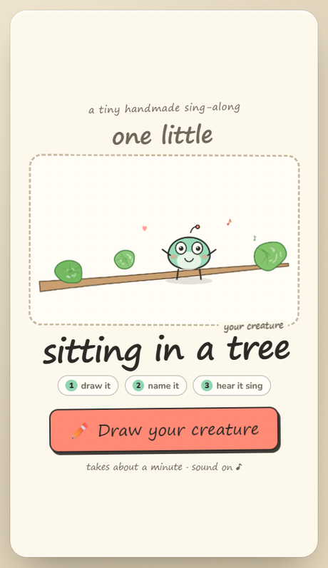

# One Little ___ Sitting in a Tree

A tiny handmade sing-along. Draw a creature, give it a name, say what it is, and hear it sung back to you:

> one little **Mochi** sitting in a tree

Your creature drops onto a hand-scribbled branch, the camera swoops around it, and the karaoke follows the voice. At the end you can save a 1080 × 1920 poster with your drawing in the tree.



## How to play

1. **Draw it** — scribble with your finger, pen or mouse. Seven colours, three brush sizes, eraser, undo/redo, clear. The paper starts transparent, so whatever you draw becomes the creature.
2. **Name it** — type a name and what it is. The name goes straight into the sung line and the poster.
3. **Hear it sing** — sound on. Four sung lines, camera shots, floating notes, and a paper end card.
4. **Keep it** — save the picture, sing it again, or draw a new one.

Tip: Chrome, Edge or Safari have the best system voices. Firefox may have none installed — the show still runs with karaoke timing, just silently.

## Run it

Everything is plain HTML/CSS/JS with no build step, no modules, no external fonts and no network requests.

### In a browser

Open `index.html` directly, or serve the folder:

```bash
python -m http.server 8000
# then open http://localhost:8000
```

### In Electron

```bash
npm install
npm start
```

`electron/main.js` is a minimal wrapper that loads `index.html` over `file://`. There is no Node access in the renderer.

### On a web page

Upload these files to any static host (GitHub Pages, Netlify, Cloudflare Pages, your own server):

```
index.html  styles.css  sketch.js  audio.js  game.js  favicon.svg
```

The stage is a fixed 9:16 card that scales to fit the window, so it works full-screen, in a phone-sized column, or inside an iframe.

## How it works

- **Drawing** — 900 × 900 transparent canvas; strokes are stored as point lists with pressure. Undo/redo snapshots the list. When you press *done*, the non-transparent bounding box is cropped, so the creature keeps its own outline.
- **Scene** — `sketch.js` pre-renders the whole tree at 2× into an offscreen canvas using seeded RNG: wobbly Catmull-Rom limbs, ink strokes, leaf clouds, grass scribbles, sun, clouds and paper grain. It is cached after first use.
- **Show** — keyframed camera (full → medium → close → wide → final), wobbly paper-reveal wipe, character drop with squash, dust puff, floating notes, sparkle bursts and a blue-sky wash on the wide shot.
- **Voice** — one `SpeechSynthesisUtterance` per line, high pitch and slow rate, with word boundaries driving the karaoke. If boundaries never arrive, a timer fallback keeps the highlight moving. The name is repeated in every line.
- **Music** — a small WebAudio band at 104 BPM over C–Am–F–G: triangle plucks, sine bass, filtered saw pad, shaker, soft kick, plus a generated reverb impulse. The music ducks under the voice. Pencil noise while drawing, pops, whooshes and chimes.
- **Poster** — the scene and drawing are recomposited at 1080 × 1920, with a paper title banner and a caption, then downloaded as `one-little-<name>.png`.

## Files

| File | What it does |
| --- | --- |
| `index.html` | All four screens: home, draw, details, show |
| `styles.css` | Paper-and-ink UI, responsive 9:16 stage, karaoke and end card |
| `sketch.js` | Seeded hand-drawn primitives, tree scene, home doodle, character layout |
| `audio.js` | WebAudio music loop, ducking, pencil and UI sounds |
| `game.js` | Screen flow, drawing/cropping, speech, show timeline, rendering, poster |
| `electron/main.js` | Optional Electron window |
| `preview.png` | Screenshot used above |

Everything runs locally. Drawings and the chosen voice never leave the device; the only stored value is the voice preference in `localStorage`.

## License

MIT — see [LICENSE](LICENSE).
